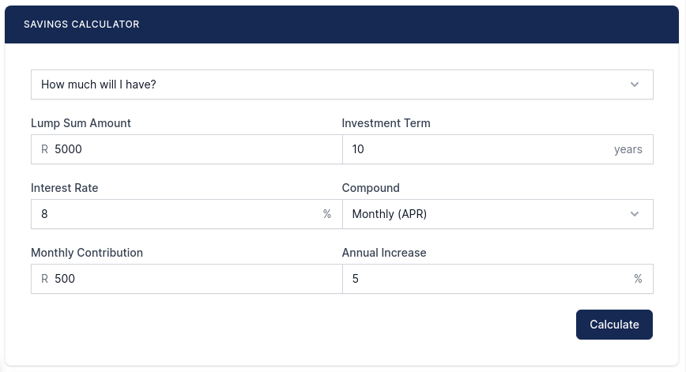
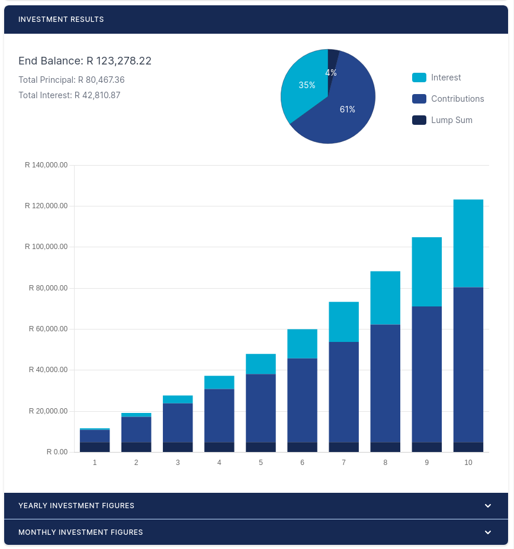

# Annuity Calculator Widget for WordPress

This is a free annuity calculator.

## Installation

1. [Download](https://github.com/Malcolm-Hall/annuity-calculator) the ZIP file of this repository.
2. [Install](https://wordpress.com/support/plugins/install-a-plugin/#install-a-plugin-with-a-zip-file) the plugin into WordPress.
3. Activate the [Annuity Calculator](https://malcolm-hall.github.io/annuity-calculator/ "Annuity Calculator Homepage") plugin through the "Plugins" menu in WordPress.

## Usage

* Add the shortcode `[mh_annuity_calculator]` to your page, post or sidebar

## Libraries in Use

1. [Chart.js](https://www.chartjs.org/)
